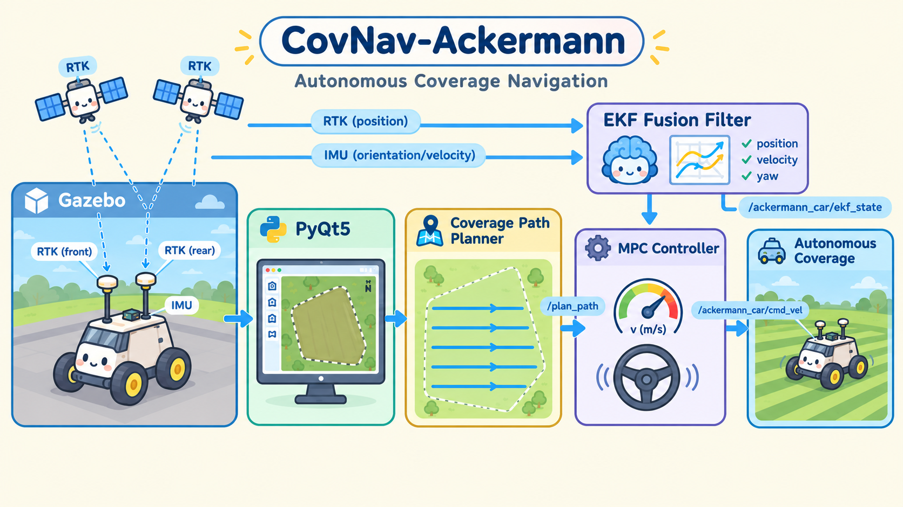
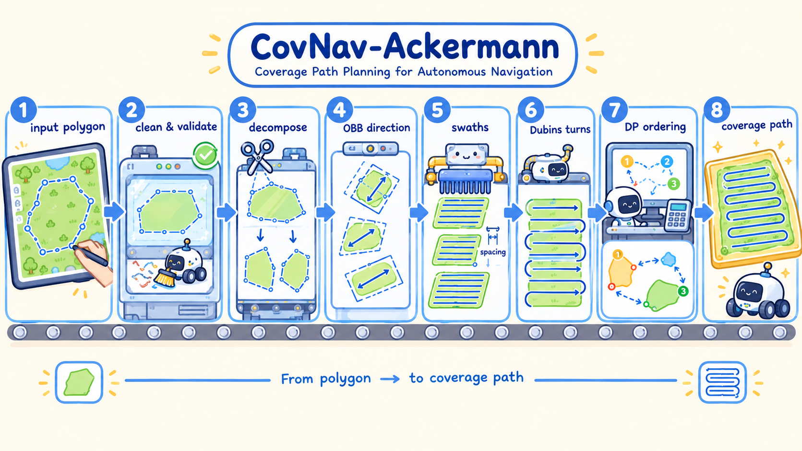

# CovNav-Ackermann

**简体中文** | [English](README_en.md)

> Ackermann（阿克曼转向）小车全覆盖导航仿真项目 · ROS Noetic + Gazebo


ROS1 Noetic + Gazebo 环境下的 Ackermann（阿克曼转向）小车全覆盖导航仿真工作空间——**在地图上圈一块地，小车自动规划往返式覆盖路径，并用 MPC 精确跟踪**。

本项目实现了一套 Ackermann 小车全覆盖导航的完整仿真流程：用户在 PyQt5 GUI 中加载地形图、交互式绘制覆盖区域，调用 C++ 覆盖路径规划服务生成 `nav_msgs/Path`，再由基于 OSQP 的 MPC 跟踪节点输出速度指令，驱动 Gazebo 中的小车完成覆盖作业。

定位链路模拟真实农机/环卫场景：由 Gazebo 真值生成前后双 RTK 天线的 `NavSatFix` 数据，与 IMU 一起经自研 EKF 融合输出车辆全状态，而非直接使用仿真真值。

规划与跟踪各有看点：规划器融合了多边形子区域分解、OBB 扫描方向选择、Dubins 风格转弯连接与 bitmask DP 区域排序等技巧；跟踪器采用有序弧长路径投影，避免覆盖航带之间"抄近道跳线"。

项目面向 Ubuntu 20.04 + ROS Noetic + Gazebo 仿真环境，定位为学习与实验性质，尚未接入实车（实机接入、Mbus 底盘通信、视觉避障均在开发计划中）。

<div align="center">
  
</div>

<p align="center"><b>图 1</b> · CovNav-Ackermann 农机自主覆盖导航总体流程：双 RTK 卫星与 IMU 数据汇入 EKF 融合，PyQt5 界面圈定覆盖多边形，规划器生成弓字形扫描路径，MPC 控制器经 /ackermann_car/cmd_vel 驱动小车完成覆盖作业。</p>

## 项目特性

- **PyQt5 交互式 GUI 圈地**：加载地形渲染图，像素坐标与世界坐标自动换算，鼠标绘制多边形覆盖区域，可调整扫描宽度、覆盖率、转弯半径后一键规划；GUI 还能按 YAML 配置直接拉起 Gazebo 仿真和 MPC 跟踪器（`scripts/coverage_navigation_gui.py`）。
- **覆盖路径规划**（`src/coverage_path_planner.cpp`）：
  - **多边形分解**：对复杂/凹多边形区域做清理、校验与子区域分解，分别生成覆盖扫描线；
  - **OBB 扫描方向**：通过 OBB 算法确定最优扫描方向，沿该方向生成等间距覆盖直线；
  - **Dubins 转弯**：使用 Dubins 风格转弯曲线连接相邻扫描线，转弯半径符合阿克曼车辆最小转弯能力；
  - **DP 区域排序**：为子区域入口/出口生成候选路径变体，按连接代价选择顺序；子区域数不超过 `exact_connection_limit` 时用精确 bitmask DP，超过则退化为贪心，避免组合爆炸。
- **OSQP MPC 路径跟踪**：状态量 `[x, y, yaw]`、控制量 `[v, yaw_rate]` 的线性化 MPC，OSQP 求解，输出 `geometry_msgs/Twist`。
- **有序路径投影防跳线**：路径按消息顺序构建弧长，投影点只沿路径单调前进、不回退；横向偏离超过 `off_path_stop_distance` 即停车报 `error:off_path`，防止车辆跳到相邻覆盖航带。
- **双 RTK + IMU EKF 定位**：由 Gazebo 位姿仿真前后双 RTK 天线输出经纬度，与 IMU 一起经 EKF 融合输出 `x/y/yaw/vx/vy` 全状态，带基线长度门限、RTK 精度分级、静止检测等工程化细节。
- **多级定位回退**：MPC 依次优先使用 `/ackermann_car/ekf_state`，超时回退 `/ackermann_car/odom`，再回退 `/odom`。
- **cmd_vel → 三轮车控制转换**：`cmd_vel_to_tricycle.py` 按 `steering_angle = atan(wheelbase * angular_z / linear_x)` 将 Twist 换算为 Gazebo 三轮车插件控制量并限幅。
- **RViz + GUI 双可视化**：Gazebo 场景、RViz（含声呐扇形 Marker）与 PyQt5 GUI 同步显示车辆位置、规划路径与跟踪状态。
- **一键安装/启动脚本**：`install.sh` 完成依赖安装与 catkin 构建，`run.sh` 清理残留 Gazebo 进程后新终端启动主入口。
- **gtest 单元测试**：`test/test_coverage_path_planner.cpp` 覆盖规划算法单测，经 `catkin run_tests` 运行。

## 项目结构

```text
CovNav-Ackermann/
├── .gitignore                     # Git 忽略规则（排除 build/、devel/ 等构建产物）
├── install.sh                     # 一键安装：apt/ROS 依赖 + rosdep + catkin build
├── run.sh                         # 一键启动：清理残留 Gazebo 进程后新终端启动主入口
├── docs/                          # 两张流程插图（pipeline.png、coverage_planner_pipeline.png）
├── README.md                      # 中文说明文档
├── README_en.md                   # 英文版说明文档
├── PROJECT_HANDOFF.md             # 项目交接文档（原理、接口、排障、开发指南）
└── src/
    └── ackermann_car_gazebo/      # 唯一 ROS 包
        ├── launch/                # 6 个 launch：GUI 主入口 / 仿真 / 规划 / EKF / MPC / RViz
        ├── config/
        │   └── coverage_navigation_params.yaml   # 所有节点的统一参数入口
        ├── scripts/               # PyQt5 GUI、cmd_vel 转换、双 RTK 发布、声呐 Marker
        ├── src/                   # C++ 源码：覆盖规划器、规划服务节点、EKF、MPC
        ├── include/
        │   └── ackermann_car_gazebo/
        │       └── coverage_path_planner.hpp     # 覆盖路径规划器头文件
        ├── msg/                   # RtkImuEkfState.msg 自定义消息
        ├── srv/                   # PlanCoveragePath.srv 规划服务定义
        ├── test/                  # gtest 单元测试
        ├── urdf/                  # 车辆 URDF（xacro）
        ├── worlds/                # Gazebo 地形世界、自动生成脚本与 GUI 背景渲染图
        ├── rviz/                  # RViz 配置
        ├── package.xml
        └── CMakeLists.txt
```

> 注：本地工作空间中的 `build/`、`devel/`、`logs/`、`.catkin_tools/` 为 catkin 构建产物，`.catkin_workspace` 为工具自动生成的工作空间标记文件，均已被 `.gitignore` 排除，不会提交入库。

## 如何安装

### 系统要求

- Ubuntu 20.04
- ROS Noetic 桌面版（**需自行先装好**，`install.sh` 只检查 `/opt/ros/noetic/setup.bash` 是否存在，不负责从零安装 ROS；安装教程见 [ROS Noetic on Ubuntu](http://wiki.ros.org/noetic/Installation/Ubuntu)）
- Gazebo（随 ROS Noetic 一起安装即可）
- 可用的 `sudo` / `apt-get`

### 获取代码

```bash
git clone <repository-url>   # 替换 <repository-url> 为本仓库实际地址
cd CovNav-Ackermann
```

### 一键安装（install.sh）

在工作空间根目录执行：

```bash
./install.sh
```

脚本依次完成：

1. 检查 `/opt/ros/noetic/setup.bash` 与 `src/` 目录存在，确认 `sudo`/`apt-get` 可用；
2. `sudo apt-get update` 并安装 apt/ROS 依赖（清单见下方"依赖"一节）；
3. 初始化（`sudo rosdep init`，若 `/etc/ros/rosdep/sources.list.d/20-default.list` 不存在）并 `rosdep update`；
4. 清理旧的 `build/ devel/ logs/` 构建产物（`catkin clean --workspace ... -y --force --all-profiles -b -d -L`）；
5. `rosdep install --from-paths src --ignore-src --rosdistro noetic -y` 安装包依赖；
6. `catkin build --workspace ... --force-cmake` 构建整个工作空间。

构建完成后加载环境：

```bash
source devel/setup.bash
```

### 手动安装

不想跑脚本时，等价命令如下：

```bash
sudo apt-get update
sudo apt-get install -y \
  build-essential cmake git \
  python3-catkin-tools python3-rosdep python3-rospkg python3-pyqt5 \
  ros-noetic-osqp-vendor ros-noetic-osqp \
  ros-noetic-gazebo-ros ros-noetic-gazebo-plugins ros-noetic-hector-gazebo-plugins \
  ros-noetic-rviz ros-noetic-rviz-plugin-tutorials \
  ros-noetic-xacro ros-noetic-robot-state-publisher
# rosdep 首次使用需先 sudo rosdep init
rosdep update
source /opt/ros/noetic/setup.bash
rosdep install --from-paths src --ignore-src --rosdistro noetic -y
catkin build
source devel/setup.bash
```

## 依赖

**ROS 包**（`package.xml` 声明）：

- **构建工具**：`catkin`（buildtool）、`cmake_modules`
- **构建**：`eigen`、`rospy`、`roscpp`、`geometry_msgs`、`nav_msgs`、`sensor_msgs`、`std_msgs`、`gazebo_msgs`、`message_filters`、`message_generation`、`urdf`、`osqp_vendor`
- **运行**：`rospy`、`roscpp`、`geometry_msgs`、`sensor_msgs`、`std_msgs`、`visualization_msgs`、`gazebo_msgs`、`message_filters`、`message_runtime`、`urdf`、`nav_msgs`、`robot_state_publisher`、`rviz`、`rviz_plugin_tutorials`、`xacro`、`gazebo_ros`、`gazebo_plugins`、`hector_gazebo_plugins`、`tf`、`python3-pyqt5`、`osqp_vendor`

**apt 包**（`install.sh` 安装）：

- **系统工具**：`build-essential`、`cmake`、`git`、`python3-catkin-tools`、`python3-rosdep`、`python3-rospkg`、`python3-pyqt5`
- **ROS**：`ros-noetic-osqp-vendor`、`ros-noetic-osqp`、`ros-noetic-gazebo-ros`、`ros-noetic-gazebo-plugins`、`ros-noetic-hector-gazebo-plugins`、`ros-noetic-rviz`、`ros-noetic-rviz-plugin-tutorials`、`ros-noetic-xacro`、`ros-noetic-robot-state-publisher`

要点：OSQP 经 `osqp_vendor`（rosdep key，对应 apt 包 `ros-noetic-osqp-vendor` + `ros-noetic-osqp`）提供；C++ 侧线性代数依赖 Eigen；GUI 依赖系统 `python3-pyqt5`。

## 快速开始

### 一键模式（run.sh）

```bash
./run.sh
```

`run.sh` 会先清理残留 Gazebo 进程，再 source ROS 与工作空间，最后在受支持的新终端（gnome-terminal / x-terminal-emulator / xfce4-terminal / konsole / xterm）中启动主入口 `roslaunch ackermann_car_gazebo coverage_navigation_gui.launch`。

### 手动 roslaunch

无受支持终端程序时：

```bash
source /opt/ros/noetic/setup.bash
source devel/setup.bash
roslaunch ackermann_car_gazebo coverage_navigation_gui.launch
```

### 单独启动各模块

`launch/` 目录下共有 6 个 launch 文件：

| launch 文件 | 作用 | 常用参数 |
| --- | --- | --- |
| `coverage_navigation_gui.launch` | **主入口**：加载 YAML、启动规划服务、GUI 与静态 map→odom TF | `start_planner`（默认 `true`）、`start_gui`（默认 `true`）、`config`（默认 `config/coverage_navigation_params.yaml`） |
| `gazebo_ackermann_car.launch` | Gazebo 仿真：世界、车辆、传感器、EKF、RViz | `world_name`、`x/y/z/yaw`、`gui`、`rviz`、`start_ekf`、`sonar_max_range_cm` 等 |
| `coverage_path_planner.launch` | 单独启动覆盖规划服务节点 | — |
| `mpc_path_tracker.launch` | 单独启动 MPC 跟踪节点 | — |
| `dual_rtk_imu_ekf.launch` | 单独启动双 RTK + IMU EKF 节点 | `robot_namespace`（默认 `ackermann_car`） |
| `rviz_ackermann_car.launch` | 单独启动 RViz | `rviz_config`、`use_sim_time` |

```bash
roslaunch ackermann_car_gazebo coverage_navigation_gui.launch start_planner:=true start_gui:=true  # 启动规划服务、GUI 与静态 map→odom TF（不启动 Gazebo 仿真与 MPC）
roslaunch ackermann_car_gazebo gazebo_ackermann_car.launch      # 单独启动仿真
roslaunch ackermann_car_gazebo mpc_path_tracker.launch          # 单独启动 MPC 跟踪器
```

默认执行主入口时**只会**拉起：YAML 参数加载、规划服务（`/coverage_path_planner`）、GUI 与静态 map→odom TF；Gazebo 仿真与 MPC 跟踪器不在主入口的开关参数之列，而是由 GUI 按钮按 YAML 中 `sim_launch` / `tracker_launch` 配置再行启动。

### GUI 操作流程

1. 启动 GUI。
2. 点击 GUI 中的仿真启动按钮，启动 Gazebo、车辆、RViz 和定位节点。
3. 在地图上绘制覆盖区域。
4. 调整扫描宽度、覆盖率、转弯半径等规划参数。
5. 点击规划按钮，GUI 调用 `/coverage_path_planner/plan_coverage_path`。
6. 确认路径显示正常后点击导航。
7. GUI 发布 `/plan_path`，并按配置启动 `mpc_path_tracker.launch`。
8. `/mpc_controller` 输出 `/ackermann_car/cmd_vel`，车辆开始跟踪。
9. 状态栏观察 `/tracking_status`，正常会经历 `tracking`，到终点后变为 `arrived`。

### 常用调试命令

```bash
rosnode list
rostopic info /plan_path
rostopic echo /tracking_status
rosservice info /coverage_path_planner/plan_coverage_path
rqt_graph
```

运行单元测试：

```bash
catkin run_tests ackermann_car_gazebo
catkin_test_results
```

### 演示截图

*以下为占位图，欢迎运行后补充实际截图。*


## 系统架构

### 控制链（GUI 圈地 → 车辆运动）

1. PyQt5 GUI（基础节点名 `coverage_navigation_gui`，脚本以 `anonymous=True` 初始化，运行时节点名会追加进程号后缀，如 `/coverage_navigation_gui_12345`）加载地形图，用户绘制多边形覆盖区域并设置规划参数。
2. GUI 调用服务 `/coverage_path_planner/plan_coverage_path`（类型 `ackermann_car_gazebo/PlanCoveragePath`）。
3. `/coverage_path_planner` 节点完成多边形分解、OBB 扫描方向、Dubins 转弯、DP 排序，返回 `nav_msgs/Path` 及统计指标。
4. GUI 将路径以 latched 方式发布到 `/plan_path`，并按 YAML 配置启动 `mpc_path_tracker.launch`（实际启动节点 `/mpc_controller`）。
5. `/mpc_controller` 订阅 `/plan_path` 与定位状态，每 `control_rate`（20 Hz）求解一次 OSQP MPC，输出 `/ackermann_car/cmd_vel`（`geometry_msgs/Twist`），同时发布 `/tracking_status`。
6. `/ackermann_car/cmd_vel_to_tricycle` 将线速度/角速度换算为前轮转角（`atan(wheelbase * angular_z / linear_x)`），发布 `/ackermann_car/tricycle_cmd`。
7. Gazebo 三轮车插件执行命令，车辆运动，RViz 与 GUI 显示。

### 覆盖路径生成流程（规划器内部）

<div align="center">
  
</div>

<p align="center"><b>图 2</b> · 覆盖路径生成的八工位卡通工厂流水线：输入多边形经清理校验、区域分解、OBB 定向、生成扫描条带、Dubins 转弯衔接、动态规划排序，最终输出覆盖路径。</p>

### 定位链（仿真真值 → EKF 状态）

1. `dual_rtk_publisher.py` 订阅 `/gazebo/model_states`，按前后天线偏移（±0.30 m）换算出两副天线的经纬高。
2. 发布 `/ackermann_car/rtk_front/fix` 与 `/ackermann_car/rtk_rear/fix`（`sensor_msgs/NavSatFix`，ENU 原点默认上海 31.230416, 121.473701）。
3. `dual_rtk_imu_ekf_node` 融合双 RTK 与 `/ackermann_car/imu/data`（`sensor_msgs/Imu`）。
4. EKF 输出 `/ackermann_car/ekf_state`（自定义类型 `ackermann_car_gazebo/RtkImuEkfState`，含 `x/y/yaw/vx/vy`）。
5. GUI 与 `/mpc_controller` 消费该状态；MPC 优先用 `ekf_state`，超时依次回退 `/ackermann_car/odom`、`/odom`。

### 核心节点

| 节点 | 来源 | 作用 |
| --- | --- | --- |
| `/coverage_navigation_gui_*` | `coverage_navigation_gui.py` | GUI、规划请求、路径发布、状态显示 |
| `/coverage_path_planner` | `coverage_path_planner_node` | 覆盖路径规划服务 |
| `/mpc_controller` | `mpc_controller_node` | OSQP MPC 路径跟踪 |
| `/ackermann_car/cmd_vel_to_tricycle` | `cmd_vel_to_tricycle.py` | Twist 到三轮车控制转换 |
| `/ackermann_car/dual_rtk_publisher` | `dual_rtk_publisher.py` | Gazebo 位姿到双 RTK |
| `/ackermann_car/dual_rtk_imu_ekf` | `dual_rtk_imu_ekf_node` | 双 RTK + IMU 定位融合 |
| `/ackermann_car/sonar_range_marker` | `sonar_range_marker.py` | 声呐 RViz Marker |

> 注：GUI 节点以 `anonymous=True` 初始化（`scripts/coverage_navigation_gui.py`），运行时实际节点名会追加进程号后缀（如 `/coverage_navigation_gui_12345`），表中 `/coverage_navigation_gui_*` 即指该基础名；其余节点名为 `rosnode list` 中的实际名称。

### 主要话题

| 话题 | 类型 | 说明 |
| --- | --- | --- |
| `/plan_path` | `nav_msgs/Path` | GUI → MPC，latched |
| `/ackermann_car/cmd_vel` | `geometry_msgs/Twist` | MPC → 转换节点；GUI 停止按钮也发零速度 |
| `/ackermann_car/tricycle_cmd` | `geometry_msgs/Twist` | 转换节点 → Gazebo 插件 |
| `/tracking_status` | `std_msgs/String` | MPC → GUI 跟踪状态 |
| `/ackermann_car/ekf_state` | `ackermann_car_gazebo/RtkImuEkfState` | EKF → GUI / MPC |
| `/ackermann_car/odom`、`/odom` | `nav_msgs/Odometry` | 备用里程计 |
| `/ackermann_car/rtk_front/fix`、`/ackermann_car/rtk_rear/fix` | `sensor_msgs/NavSatFix` | 双 RTK 仿真数据 |
| `/ackermann_car/imu/data` | `sensor_msgs/Imu` | IMU |
| `/ackermann_car/sonar/range` | `sensor_msgs/Range` | 声呐测距（当前仅可视化，不参与控制） |
| `/ackermann_car/sonar/marker` | `visualization_msgs/Marker` | 声呐扇形可视化 |

### 服务

`/coverage_path_planner/plan_coverage_path`，类型 `ackermann_car_gazebo/PlanCoveragePath`：

- **请求**核心字段：`polygon`（`geometry_msgs/Point[]`，覆盖区域多边形顶点）、`use_robot_start` / `robot_start` / `use_robot_start_heading`（起点位姿接入）、`scan_width`、`coverage_ratio`、`turn_radius`、`turn_step`、`start_connection_weight`；
- **响应**核心字段：`success`、`message`、`path`（`nav_msgs/Path`）、`num_lines`、`decomposition_count`、`line_spacing`、`total_path_cost`、`internal_path_cost`、`smooth_connection_cost`、`start_connection_cost`、`selected_variant_indices`、`connection_order`。

**自定义消息** `ackermann_car_gazebo/RtkImuEkfState`：`header` + `float64 x/y/yaw/vx/vy`（地图系二维位姿 + 平面速度）。

### tracking_status 取值

| 状态 | 含义 |
| --- | --- |
| `idle` | 无有效路径，或收到空路径 |
| `tracking` | 正在跟踪路径 |
| `arrived` | 已到达终点，节点发布零速度 |
| `error:no_state` | EKF/odom/fallback odom 都超时或无效 |
| `error:off_path` | 车辆横向偏离当前有序路径超过阈值 |
| `error:optimization` | OSQP 求解未成功 |

## 参数配置

所有节点参数统一在 `src/ackermann_car_gazebo/config/coverage_navigation_params.yaml` 配置（仅由 `coverage_navigation_gui.launch` 加载一次，按节点名分组）。地图与规划统一使用 ENU 坐标（x=East，y=North，z=Up）。

### 规划参数（coverage_path_planner）

| 参数 | 默认值 | 含义 |
| --- | --- | --- |
| `scan_width` | `1.0` | 扫描宽度（m），与 `coverage_ratio` 相乘得到航带间距；GUI 请求中 `scan_width > 0` 时覆盖该默认值 |
| `coverage_ratio` | `0.8` | 覆盖系数（0~1），越大航带间距越小、扫描线越密 |
| `turn_radius` | `2.0` | Dubins 掉头半径（m） |
| `turn_step` | `0.1` | Dubins 曲线离散采样步长（m） |
| `straight_step` | `0.80` | 覆盖直线段离散采样步长（m） |
| `start_connection_weight` | `1.0` | 起点接入代价权重，0 表示不考虑 |
| `exact_connection_limit` | `16` | 精确 bitmask DP 的最大子区域数，超过退化为贪心 |
| `nonadjacent_penalty` | `10.0` | 非相邻子区域连接惩罚 |
| `frame_id` | `"map"` | 规划路径坐标系 |

> 两者联合语义：航带间距 `line_spacing = scan_width × coverage_ratio`（默认 `1.0 × 0.8 = 0.80` m），即 `scan_width` 定基准宽度、`coverage_ratio` 按比例收紧间距。

### 跟踪参数（mpc_controller）

| 参数 | 默认值 | 含义 |
| --- | --- | --- |
| `control_rate` | `20.0` | 控制循环频率（Hz） |
| `wheelbase` | `0.60` | 前后轴距（m），须与 URDF/转换节点一致 |
| `target_speed` | `0.80` | 目标巡航速度（m/s） |
| `min_linear_velocity` / `max_linear_velocity` | `0.0` / `1.20` | 线速度上下限（m/s） |
| `goal_tolerance` | `0.35` | 到达终点判定距离（m） |
| `state_timeout` | `0.75` | 状态消息超时（s），超过发布 `error:no_state` |
| `max_steering_angle` | `0.60` | 最大前轮转角（rad） |
| `max_angular_velocity` | `1.4` | 最大角速度（rad/s） |
| `slowdown_distance` | `1.5` | 终点减速距离（m） |
| `off_path_stop_distance` | `1.80` | 横向偏离停车阈值（m），超过发布 `error:off_path` |
| `lookahead_time` / `min_lookahead_dist` / `max_lookahead_dist` | `1.0` / `0.50` / `1.40` | 前视距离 = clamp(\|v\|·lookahead_time, min, max) |
| `control_dt` | `0.10` | 预测模型离散步长（s） |
| `predict_time_domain` / `control_time_domain` | `10` / `4` | 预测域 / 控制域步数 |
| `q_matrix_x` / `q_matrix_y` / `q_matrix_theta` | `12.0` / `12.0` / `3.0` | 状态误差权重，对应 [x, y, yaw] |
| `r_matrix_v` / `r_matrix_w` | `0.8` / `0.8` | 控制量权重，对应 [v, yaw_rate] |
| `delta_linear_velocity_min` / `max` | `-0.20` / `0.12` | 单步线速度增量约束 |
| `delta_angular_velocity_min` / `max` | `-0.30` / `0.30` | 单步角速度增量约束 |

### 其他关键参数

| 参数 | 默认值 | 含义 |
| --- | --- | --- |
| `use_sim_time` | `true` | 仿真使用 Gazebo `/clock`，实车通常改 `false` |
| `coverage_navigation_gui/render_path` | `package://ackermann_car_gazebo/worlds/render.png` | GUI 地形渲染图 |
| `coverage_navigation_gui/map_world_size_m` | `129.0` | 地形图对应真实世界边长（m） |
| `ackermann_car/cmd_vel_to_tricycle/wheelbase` | `0.60` | 须与 MPC 侧 `wheelbase` 保持一致 |
| `ackermann_car/cmd_vel_to_tricycle/max_steering_angle` | `0.60` | 须与 MPC 侧保持一致 |
| `ackermann_car/dual_rtk_imu_ekf/rtk_position_std` | `0.03` | RTK 位置测量标准差（m） |
| `ackermann_car/dual_rtk_imu_ekf/dual_rtk_yaw_std` | `0.03` | 双 RTK 航向测量标准差（rad） |
| `ackermann_car/dual_rtk_imu_ekf/expected_rtk_baseline` | `0.60` | 期望前后 RTK 基线长度（m） |

## 说明

- **仿真时间**：全局 `use_sim_time: true`，所有节点使用 Gazebo `/clock`；真实车辆运行时通常改为 `false`。
- **wheelbase 与 max_steering_angle 一致性**：`mpc_controller` 与 `ackermann_car/cmd_vel_to_tricycle` 两处的 `wheelbase: 0.60`、`max_steering_angle: 0.60` 必须保持一致，且与车辆 URDF 匹配，否则会出现"车辆不转弯或转弯半径不对"。
- **launch 文件名兼容**：`mpc_path_tracker.launch` 为兼容旧 GUI 入口保留该文件名，实际启动的是 `mpc_controller_node`（节点名 `/mpc_controller`）。
- **Gazebo 残留进程**：异常退出后 Gazebo 可能残留进程，可手动清理（`run.sh` 已内置）：

  ```bash
  pkill -TERM -x gzclient || true
  pkill -TERM -x gzserver || true
  pkill -TERM -x gazebo || true
  ```

- **参数只在一处加载**：正常使用时只有 `coverage_navigation_gui.launch` 加载 YAML，其他 launch 不再单独加载、也不重复写死节点参数。因此**单独启动** `gazebo_ackermann_car.launch`、`mpc_path_tracker.launch` 等模块时，各节点回退到代码内默认参数，取值可能与 YAML 不同（例如规划器 `turn_radius` 代码默认为 `0.5`，YAML 为 `2.0`），行为与 GUI 模式不完全一致；调试单模块时可先手动加载参数再启动：

  ```bash
  rosparam load src/ackermann_car_gazebo/config/coverage_navigation_params.yaml
  ```

- **坐标约定**：地图与规划统一使用 ENU 笛卡尔坐标（x=East，y=North，z=Up）。
- **声呐仅可视化**：声呐数据当前只经 `sonar_range_marker.py` 转 RViz Marker 显示，不参与控制或避障（避障在路线图第 4 项）。
- **排障**：常见问题（`roslaunch` 找不到包、GUI 地图不显示、`error:no_state` / `error:off_path` / `error:optimization`、`install.sh` 失败等）见 [PROJECT_HANDOFF.md](PROJECT_HANDOFF.md) 第 9 章。

## 路线图（Roadmap）

1. **实机 bag 数据录制和回放、运行视频**：录制实车运行 bag 与视频，建立“采集 → 回放 → 调参 → 再上车”的闭环，并补充运行演示视频。
2. **统一时间戳与 ENU 原点**：打通各传感器与底盘数据的时间同步，固定统一的 ENU 原点，消除仿真与实机在时间与坐标上的差异。
3. **上传上下位机 Mbus 通信代码**：开源 Mbus 协议底盘通信节点，含通信超时安全停车与 `mbus/tx`、`mbus/rx` 调试话题。
4. **上传摄像头和超声波识别避障代码**：开源 YOLO 视觉识别 + 超声波补盲的避障模块，含可通行类别白名单与安全停车策略。

## 贡献

欢迎通过 Issue 与 Pull Request 参与改进：bug 反馈、文档勘误、测试用例、参数调优经验都可以。提交前建议先跑通 `catkin build` 与 `catkin run_tests ackermann_car_gazebo`。

## 鸣谢

- MPC 路径跟踪节点的算法核心源自开源 **MPC local planner** 的 QP（二次规划）思路改写，并移除了原项目的 `pluginlib`、`nav_core`、`costmap_2d` 依赖，改造为独立 ROS 节点（求解器改用 OSQP，模型为 `[x, y, yaw]` / `[v, yaw_rate]`）。
- 感谢 [ROS](https://www.ros.org/)、[Gazebo](https://gazebosim.org/)、[OSQP](https://osqp.org/)、[Eigen](https://eigen.tuxfamily.org/) 与 [PyQt5](https://www.riverbankcomputing.com/software/pyqt/) 等开源项目。

## 许可证

本项目采用 [MIT License](https://opensource.org/licenses/MIT)（见 `src/ackermann_car_gazebo/package.xml` 中的 `<license>` 声明）。仓库根目录尚未包含 LICENSE 全文文件，正式发布前建议补充。

## 支持

- 使用问题与排障请先查阅 [PROJECT_HANDOFF.md](PROJECT_HANDOFF.md)（尤其第 9 章"常见问题和排障"）与本文"说明"一节；
- 未解决欢迎开 Issue，附上 `rqt_graph` 截图与 `/tracking_status` 输出会更易定位；
- 如果这个项目对你有帮助，欢迎点一个 ⭐ Star 支持一下！
